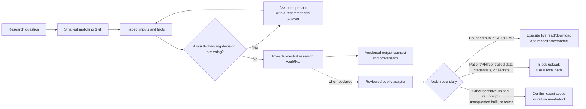

# Bio 02 Skills

Research-first bioinformatics skills for AI agents.

Bio 02 Skills is a focused collection of 23 Agent Skills for common bioinformatics and biostatistics tasks. Each Skill owns one job, declares the inputs and outputs it expects, routes away from neighboring tasks, and records the tool, database, network, and interpretation boundaries that matter to a researcher.

| Current version | Packages | Release status | External services |
| --- | ---: | --- | --- |
| `0.4.1` | 23 | `preview + reviewed` | Bounded public read/download; anonymous-first |

## Why Bio 02 Skills

- **Research question first.** The agent establishes the scientific task, assumptions, and available evidence before choosing a tool.
- **One job per Skill.** Sequence I/O, alignment handling, differential expression, enrichment, single-cell analysis, structure comparison, statistics, and literature work have separate boundaries.
- **Facts before questions.** The agent inspects what is safely discoverable, then asks one recommended question only when an unresolved choice would change the result.
- **Version-aware guidance.** Packages record the relevant tool, interface, and database versions or freshness dates.
- **Truthful execution.** Missing inputs, unresolved decisions, unavailable tools, partial retrievals, and failed calls are reported explicitly instead of being presented as completed analysis.
- **Provider-neutral core.** Reviewed public services extend a Skill when needed without becoming an implicit requirement for offline work.

## How it works



The detailed interaction and connector rules are in [docs/architecture.md](docs/architecture.md).

## Getting started

Clone the repository:

```bash
git clone https://github.com/SteveTangent/02-bio-skills.git
cd 02-bio-skills
```

Choose a Skill from [`skills/`](skills/) and install the complete `skills/<slug>/` directory in an Agent Skills-compatible host. Keep its `LICENSE`, `SKILL.md`, manifest, interface, references, and scripts together. The repository root is a catalog, not a single installable Skill.

Then ask your agent naturally, for example:

```text
Validate this VCF's representation and reference-build assumptions before normalization.

Plan a count-based differential-expression analysis for this sample sheet and count matrix.

Inspect this single-cell object, define QC decisions, and identify what can be run safely.

Apply Holm correction at alpha 0.05 to these already-computed p-values as one declared family.

Search public studies on human liver fibrosis and return a traceable result set.
```

## Skill catalog

| Research area | Skills |
| --- | --- |
| Data and workflow foundations | `bioinformatics-format-and-identifier-validation`<br>`scientific-file-preflight-and-resource-planning`<br>`biological-database-record-retrieval-and-identifier-resolution`<br>`environment-and-provenance-capture` |
| Sequence, reads, genomes, and evolution | `sequence-io-and-transformation`<br>`sequence-similarity-and-homology-search`<br>`pairwise-and-multiple-sequence-alignment`<br>`alignment-file-operations`<br>`genomic-interval-operations` |
| Variant and cohort genomics | `vcf-normalization-qc-and-query` |
| Bulk transcriptomics | `count-based-differential-expression` |
| Single-cell analysis | `single-cell-object-io-and-qc`<br>`single-cell-core-analysis` |
| Proteomics | `proteomics-quantification-table-qc` |
| Protein structure | `protein-structure-retrieval-and-comparison` |
| Cheminformatics | `molecule-standardization-and-descriptors`<br>`chemical-similarity-and-substructure-search` |
| Functional interpretation | `over-representation-analysis`<br>`ranked-gene-set-enrichment` |
| Study design and biostatistics | `experimental-design-power-and-batch-planning`<br>`statistical-analysis-and-multiple-testing` |
| Biomedical evidence | `biomedical-literature-and-public-study-search`<br>`evidence-synthesis-and-research-traceability` |

See [docs/catalog.md](docs/catalog.md) for Domain, Cluster, risk, dependency, and runtime details. [`registry.json`](registry.json) is the versioned machine-readable index.

## External research services

An explicit request to search or retrieve from a declared public research
database authorizes the matching bounded read and requested download. Ordinary
public access uses reviewed HTTPS hosts, `GET` or `HEAD`, per-invocation pacing,
and response-size limits; it does not require a second acknowledgement.
Provider pacing is enforced within one invocation, while the agent host must
coordinate concurrent workers that share a provider or source address.

The shared executor is anonymous-only: it does not read contact, API-key, token,
or paid-credential variables. A user-supplied host adapter may manage identity
separately after disclosing that boundary. Paid or metered providers are absent
from the active catalog.

Patient data, protected health information, controlled-access data,
credentials, and secrets are never uploaded. Separate confirmation is reserved
for non-prohibited sensitive material such as proprietary or unpublished data;
starting a remote compute job; expanding into bulk work that the user did not
request; or accepting provider-specific terms such as KEGG's academic-use
boundary. The shared companion currently executes bounded `GET` and `HEAD`
requests only. Conditional job providers such as hosted alignment and remote
BLAST require a reviewed host adapter; without one, the Skill returns
`needs-tool` instead of implying submission.

For example, this command performs a live bounded UniProt retrieval and writes
both the response and a separate provenance record:

```bash
python3 scripts/run_research_connector.py \
  --provider uniprot-rest \
  --url https://rest.uniprot.org/uniprotkb/P04637.json \
  --output results/P04637.json
```

The shared companion emits `completed` only after the response and create-new
publication contract were checked; this is not a claim that the record is
scientifically relevant or biologically correct. Otherwise it emits
`blocked-or-failed` and reports whether any network request occurred. At the
Skill layer, incomplete or truncated work remains explicitly partial and
non-completed, and an unsupported job returns `needs-tool`. Live provenance
records the provider, redacted request URL, method, timestamps, response
metadata, byte count, digest, output path, anonymous execution state, terms
state, and `network_performed=true`.

### External API, data, and tool terms

Apache-2.0 covers Bio 02 Skills itself. External APIs, databases, downloaded datasets, and research tools keep their providers' own terms, licenses, citation requirements, access rules, and usage limits. Comply with the applicable terms before using external data or software; terms-restricted paths require the declared acknowledgement.

## Package contents

Each installable package contains the files needed for that Skill:

```text
skills/<slug>/
├── LICENSE                  Apache-2.0 terms for standalone distribution
├── SKILL.md
├── manifest.json
├── agents/interface.yaml
├── references/              optional
├── scripts/                 optional, with a deterministic self-test
└── security/                optional permission policy
```

## Current release boundary

All 23 packages are `preview + reviewed`. Their instructions, interfaces, package structure, declared versions, and safety boundaries have been reviewed, but many external-tool paths have not been executed end to end. A package states those unverified boundaries in its manifest.

Use the collection for supervised research work. Verify inputs, tool availability, QC, and biological interpretation for each project. The collection does not claim universal scientific correctness, clinical authority, or superiority over another workflow.

## Repository checks

The repository includes dependency-free checks for package structure and the shared connector contract:

```bash
python3 scripts/validate_skeleton.py
python3 scripts/validate_skeleton.py --self-test
python3 scripts/run_research_connector.py --self-test
python3 skills/scientific-file-preflight-and-resource-planning/scripts/preflight_files.py --self-test
python3 skills/statistical-analysis-and-multiple-testing/scripts/adjust_pvalues.py --self-test
```

The skeleton gate also validates the 19 deterministic intake-routing cases in
[`evals/intake-routing-cases.json`](evals/intake-routing-cases.json). Those
fixtures test routing and first-question contracts; they are not a claim of
model-runtime or scientific evaluation.

## License

Bio 02 Skills is licensed under the [Apache License 2.0](LICENSE). Each installable Skill carries the same license text so the terms remain available when a package is installed on its own.

- [Architecture](docs/architecture.md)
- [Catalog](docs/catalog.md)
- [Quality standard](docs/quality-standard.md)
- [Release flow](docs/release-flow.md)
- [Contributing](CONTRIBUTING.md)
