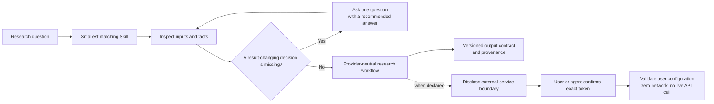

# Bio 02 Skills

Research-first bioinformatics skills for AI agents.

Bio 02 Skills is a focused collection of 20 Agent Skills for common bioinformatics and biostatistics tasks. Each Skill owns one job, declares the inputs and outputs it expects, routes away from neighboring tasks, and records the tool, database, network, and interpretation boundaries that matter to a researcher.

| Current version | Packages | Release status | External services |
| --- | ---: | --- | --- |
| `0.2.1` | 20 | `preview + reviewed` | User-configured, disclosure-first, plan-only |

## Why Bio 02 Skills

- **Research question first.** The agent establishes the scientific task, assumptions, and available evidence before choosing a tool.
- **One job per Skill.** Sequence I/O, alignment handling, differential expression, enrichment, single-cell analysis, structure comparison, statistics, and literature work have separate boundaries.
- **Facts before questions.** The agent inspects what is safely discoverable, then asks one recommended question only when an unresolved choice would change the result.
- **Version-aware guidance.** Packages record the relevant tool, interface, and database versions or freshness dates.
- **Fail-closed behavior.** Missing inputs, unresolved decisions, unavailable tools, or absent configuration are reported explicitly instead of being presented as completed analysis.
- **Provider-neutral core.** External services are isolated behind a shared configuration boundary and never become an implicit requirement for offline work.

## How it works



The detailed interaction and connector rules are in [docs/architecture.md](docs/architecture.md).

## Getting started

Clone the repository:

```bash
git clone https://github.com/SteveTangent/02-bio-skills.git
cd 02-bio-skills
```

Choose a Skill from [`skills/`](skills/) and install the complete `skills/<slug>/` directory in an Agent Skills-compatible host. Keep its `LICENSE`, `SKILL.md`, manifest, interface, references, and scripts together. The repository root is a catalog, not a single installable Skill.

Then ask your agent naturally, for example:

```text
Validate this VCF's representation and reference-build assumptions before normalization.

Plan a count-based differential-expression analysis for this sample sheet and count matrix.

Inspect this single-cell object, define QC decisions, and identify what can be run safely.

Apply Holm correction at alpha 0.05 to these already-computed p-values as one declared family.

Build a traceable search plan for public studies on human liver fibrosis.
```

## Skill catalog

| Research area | Skills |
| --- | --- |
| Data and workflow foundations | `bioinformatics-format-and-identifier-validation`<br>`environment-and-provenance-capture` |
| Sequence, reads, genomes, and evolution | `sequence-io-and-transformation`<br>`sequence-similarity-and-homology-search`<br>`pairwise-and-multiple-sequence-alignment`<br>`alignment-file-operations`<br>`genomic-interval-operations` |
| Variant and cohort genomics | `vcf-normalization-qc-and-query` |
| Bulk transcriptomics | `count-based-differential-expression` |
| Single-cell analysis | `single-cell-object-io-and-qc`<br>`single-cell-core-analysis` |
| Protein structure | `protein-structure-retrieval-and-comparison` |
| Cheminformatics | `molecule-standardization-and-descriptors`<br>`chemical-similarity-and-substructure-search` |
| Functional interpretation | `over-representation-analysis`<br>`ranked-gene-set-enrichment` |
| Study design and biostatistics | `experimental-design-power-and-batch-planning`<br>`statistical-analysis-and-multiple-testing` |
| Biomedical evidence | `biomedical-literature-and-public-study-search`<br>`evidence-synthesis-and-research-traceability` |

See [docs/catalog.md](docs/catalog.md) for Domain, Cluster, risk, dependency, and runtime details. [`registry.json`](registry.json) is the versioned machine-readable index.

## External research services

Some Skills declare an external service, but Bio 02 Skills never reads configuration silently.

Phase 1 prints the provider, purpose, data that would be sent, credential requirements, billing or rate limits, allowed hosts, and output boundary. It returns a deterministic confirmation token without reading a configuration file:

```bash
python3 scripts/check_research_connectors.py --provider openalex
```

After the user or supervising agent reviews that disclosure, Phase 2 requires both the exact token and a local configuration path:

```bash
python3 scripts/check_research_connectors.py \
  --provider openalex \
  --acknowledge bio02-ack-v1-<exact-token-from-phase-1> \
  --config /path/to/research-connectors.json
```

The configuration contains provider enablement and `BIO02_...` environment-variable names, never credential values. Missing or mismatched confirmation leaves the configuration unread. Missing configuration or credentials returns an explicit `needs-user-config` or `needs-credential` result.

The v0.2.1 connector doctor is deliberately **plan-only**: `config-validated` does not mean an API call was made. It always reports `network_performed=false`, `live_ready=false`, and `paid_use_authorized=false`. See [connectors/README.md](connectors/README.md) for the provider catalog and configuration example.

### External API, data, and tool terms

Apache-2.0 covers Bio 02 Skills itself. External APIs, databases, downloaded datasets, and research tools keep their providers' own terms, licenses, citation requirements, access rules, and usage limits. Review the applicable provider terms before enabling a connector or using external data or software.

## Package contents

Each installable package contains the files needed for that Skill:

```text
skills/<slug>/
├── LICENSE                  Apache-2.0 terms for standalone distribution
├── SKILL.md
├── manifest.json
├── agents/interface.yaml
├── references/              optional
├── scripts/                 optional, with a deterministic self-test
└── security/                optional permission policy
```

## Current release boundary

All 20 packages are `preview + reviewed`. Their instructions, interfaces, package structure, declared versions, and safety boundaries have been reviewed, but many external-tool paths have not been executed end to end. A package states those unverified boundaries in its manifest.

Use the collection for supervised research work. Verify inputs, tool availability, QC, and biological interpretation for each project. The collection does not claim universal scientific correctness, clinical authority, or superiority over another workflow.

## Repository checks

The repository includes dependency-free checks for package structure and the shared connector contract:

```bash
python3 scripts/validate_skeleton.py
python3 scripts/validate_skeleton.py --self-test
python3 scripts/check_research_connectors.py --self-test
```

## License

Bio 02 Skills is licensed under the [Apache License 2.0](LICENSE). Each installable Skill carries the same license text so the terms remain available when a package is installed on its own.

- [Architecture](docs/architecture.md)
- [Catalog](docs/catalog.md)
- [Quality standard](docs/quality-standard.md)
- [Release flow](docs/release-flow.md)
- [Contributing](CONTRIBUTING.md)
