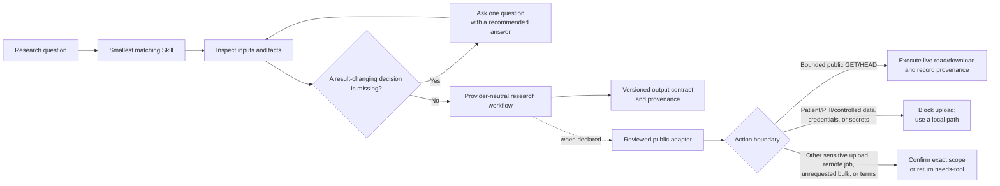

<p align="center">
  
</p>

<p align="center">
  <sub>Image source: <a href="https://uwaterloo.ca/support/goose-loose-holiday-contest">University of Waterloo — “The Goose is on the Loose”</a>. This independent project is not affiliated with or endorsed by the University of Waterloo.</sub>
</p>

# Goose Bio Skills

Practical bioinformatics skills for AI agents, with explicit scientific boundaries.

Goose Bio Skills is a focused collection of one-job Agent Skills for common bioinformatics and biostatistics tasks. The current working tree contains **57 packages across 13 Domains and 27 Clusters**, 42 packages at `0.10.0`, nine at `0.11.0` and six at `0.12.0`, with 38 bounded helpers. The immutable collection release remains `v0.9.0`; main contains a reviewed preview, not a newly tagged collection release.

| Boundary | Packages | State | External services |
| --- | ---: | --- | --- |
| Immutable `v0.9.0` release | 48 | `preview + reviewed`; see package versions in the registry | Bounded public read/download; anonymous-first |
| Current working-tree preview | 57 | `preview + reviewed` | Local helpers plus existing bounded public adapters |
| Unpublished candidate branches | Outside the working-tree catalog | Candidates require a separate promotion decision | Candidate-specific |

Start with [expression workflows](docs/expression-workflows.md) for counts, reviewed pseudobulk or normalized microarrays, or [task bundles](docs/task-bundles.md) for other inputs.

## Why Goose Bio Skills

- **Research question first.** The agent establishes the scientific task, assumptions, and available evidence before choosing a tool.
- **One job per Skill.** Sequence I/O, alignment handling, differential expression, enrichment, single-cell analysis, structure comparison, statistics, and literature work have separate boundaries.
- **Facts before questions.** The agent inspects what is safely discoverable, then asks one recommended question only when an unresolved choice would change the result.
- **Version-aware guidance.** Packages record the relevant tool, interface, and database versions or freshness dates.
- **Truthful execution.** Missing inputs, unresolved decisions, unavailable tools, partial retrievals, and failed calls are reported explicitly instead of being presented as completed analysis.
- **Provider-neutral core.** Reviewed public services extend a Skill when needed without becoming an implicit requirement for offline work.

## How it works



The detailed interaction and connector rules are in [docs/architecture.md](docs/architecture.md).

## 快速开始

多步骤任务可从 [分析流程入口](docs/analysis-workflow.md) 开始：复用已确认事实，检查已有结果，生成包含图表、方法和待补充事项的目录。这个可选工具保持本地，不执行分析或安装依赖。

从 [任务包](docs/task-bundles.md) 选择需要的 Skill，先检查本地依赖，再运行 [几 KB 的示例](examples/efficiency/README.md)。也可以运行 [约 100 KB 的扩展示例](examples/expansion/README.md)：两组比较、相关分析、结果对照，以及单细胞 QC、聚类、marker 证据和 pseudobulk。配套图表、方法记录和中英文报告。

每个 Skill 都会先读已有事实，遇到关键缺失再具体反问，解释影响结果的术语，并提醒有证据支持的误区。输入齐全时直接推进。看 [对话示例](docs/user-experience.md)。

## Getting started

Clone the repository:

```bash
git clone https://github.com/SteveTangent/goose-bio-skills.git
cd goose-bio-skills
```

Choose a Skill from [`skills/`](skills/) and install the complete `skills/<slug>/` directory in an Agent Skills-compatible host. Keep its `LICENSE`, `SKILL.md`, manifest, interface, references, and scripts together. The repository root is a catalog, not a single installable Skill.

Install only the Skills needed for a project using the [selected installation guide](docs/install-selected-skills.md). For the current changes and evidence boundaries, read the [unreleased upgrade notes](docs/unreleased-upgrade.md).

Proposed workflow improvements and the next small analysis additions are in [next steps](docs/next-steps.md); these are plans, not installed capabilities.

For a first checked local result, follow the [offline starter example](docs/offline-starter.md). It includes synthetic input, the exact command, and expected output values.

The current catalog has 37 packages with bundled helpers and 19 without bundled scripts. Helpers cover bounded tasks; guidance packages require the declared tools or a compatible adapter for execution. A bundled helper is not evidence that the entire scientific workflow has been evaluated. Fourteen packages declare network services as required or optional. Installing a Skill directory does not install the shared connector; see the [network integration boundary](docs/integration-contract.md#networked-skills).

Then ask your agent naturally, for example:

```text
Validate this VCF's representation and reference-build assumptions before normalization.

Plan a count-based differential-expression analysis for this sample sheet and count matrix.

Inspect this single-cell object, define QC decisions, and identify what can be run safely.

Apply Holm correction at alpha 0.05 to these already-computed p-values as one declared family.

Search public studies on human liver fibrosis and return a traceable result set.

Retrieve a bounded ENA run/file manifest for SRR390728 without downloading reads.

Resolve the name Escherichia coli to NCBI TaxIds and preserve ambiguous matches.

Review these local FastQC reports and summarize read-quality warnings without trimming reads.

Trim the declared adapters from this small paired FASTQ set with the approved filter policy and write new synchronized outputs.

Check this GTF for structural and gene-model consistency without rewriting it.

Inspect this local FCS file's datasets and channel metadata without compensation or gating.

Profile this table's missing outcome values and run only the bounds and delta scenarios I declared.

Report heavy-atom residue contacts between chains A and B in this local PDB at a fixed cutoff.

Retrieve Ensembl Compara orthology assertions for these exact gene IDs from source species homo_sapiens to target species mus_musculus.

Check this local amplicon feature table, metadata, and taxonomy table without filtering or diversity analysis.

Audit these declared-build narrowPeak files against pinned contig sizes and a blacklist without calling peaks.

Fit the declared contrast on this normalized log2 protein matrix with the pinned local limma adapter.

Check this local Newick tree and compare its exact tip set without inferring or rewriting a tree.

Inspect this untargeted-metabolomics feature table and metadata without normalization, imputation, or compound annotation.

Align this tiny single-end short-DNA FASTQ to the exact local reference using the supplied digest-pinned minimap2 executable.
```

## Skill catalog

| Research area | Skills |
| --- | --- |
| Data and workflow foundations | `bioinformatics-format-and-identifier-validation`<br>`scientific-file-preflight-and-resource-planning`<br>`biological-database-record-retrieval-and-identifier-resolution`<br>`taxonomy-name-and-taxid-resolution`<br>`public-sequencing-run-manifest-retrieval`<br>`environment-and-provenance-capture` |
| Sequence, reads, genomes, and evolution | `sequence-io-and-transformation`<br>`sequence-similarity-and-homology-search`<br>`pairwise-and-multiple-sequence-alignment`<br>`phylogenetic-tree-io-and-qc`<br>`raw-read-quality-reporting`<br>`raw-read-trimming-and-filtering`<br>`read-alignment-selection-and-execution`<br>`alignment-file-operations`<br>`genomic-interval-operations`<br>`gff-gtf-gene-model-qc`<br>`public-orthology-retrieval-and-qc` |
| Variant and cohort genomics | `vcf-normalization-qc-and-query`<br>`human-variant-evidence-retrieval` |
| Bulk transcriptomics | `count-based-differential-expression`<br>`bulk-rnaseq-gene-counting-from-alignment`<br>`bulk-rnaseq-gene-count-matrix-assembly`<br>`junction-psi-and-delta-analysis` |
| Single-cell analysis | `single-cell-object-io-and-qc`<br>`single-cell-core-analysis` |
| Epigenomics | `chromatin-peak-set-qc` |
| Microbiome and amplicon data | `amplicon-feature-table-and-taxonomy-qc`<br>`amplicon-alpha-diversity-analysis`<br>`amplicon-beta-diversity-distance-analysis` |
| Proteomics, metabolomics, and cytometry | `proteomics-quantification-table-qc`<br>`protein-level-differential-abundance`<br>`untargeted-metabolomics-feature-table-qc`<br>`fcs-file-io-and-metadata-qc`<br>`flow-cytometry-compensation-application`<br>`flow-cytometry-arcsinh-transformation` |
| Protein structure | `protein-structure-retrieval-and-comparison`<br>`protein-interface-contact-analysis` |
| Cheminformatics | `molecule-standardization-and-descriptors`<br>`chemical-similarity-and-substructure-search` |
| Functional interpretation | `over-representation-analysis`<br>`ranked-gene-set-enrichment` |
| Study design and biostatistics | `experimental-design-power-and-batch-planning`<br>`statistical-analysis-and-multiple-testing`<br>`missing-data-and-sensitivity-analysis`<br>`kaplan-meier-survival-analysis`<br>`two-group-log-rank-survival-comparison` |
| Biomedical evidence | `biomedical-literature-and-public-study-search`<br>`evidence-synthesis-and-research-traceability` |

Wave R5 added `bulk-rnaseq-gene-count-matrix-assembly`, `amplicon-beta-diversity-distance-analysis`, `two-group-log-rank-survival-comparison`, and `flow-cytometry-arcsinh-transformation` to the v0.9.0 Beta. They remain `preview + reviewed`; promotion does not upgrade them to evaluated or stable assurance.

See [docs/catalog.md](docs/catalog.md) for Domain, Cluster, risk, dependency, and runtime details. [`registry.json`](registry.json) is the versioned machine-readable index.

The [integration contract](docs/integration-contract.md) separates user
questions, presentation metadata, permission declarations, status language,
and host responsibilities. Users are not expected to read or complete the
package governance files.

## External research services

An explicit request to search or retrieve from a declared public research
database authorizes the matching bounded read and requested download. Ordinary
public access uses reviewed HTTPS hosts, `GET` or `HEAD`, per-invocation pacing,
and response-size limits; it does not require a second acknowledgement.
Provider pacing is enforced within one invocation, while the agent host must
coordinate concurrent workers that share a provider or source address.

The shared executor is anonymous-only: it does not read contact, API-key, token,
or paid-credential variables. A user-supplied host adapter may manage identity
separately after disclosing that boundary. Paid or metered providers are absent
from the active catalog.

Patient data, protected health information, controlled-access data,
credentials, and secrets are never uploaded. Separate confirmation is reserved
for non-prohibited sensitive material such as proprietary or unpublished data;
starting a remote compute job; expanding into bulk work that the user did not
request; or accepting provider-specific terms such as KEGG's academic-use
boundary. The shared companion currently executes bounded `GET` and `HEAD`
requests only. Conditional job providers such as hosted alignment and remote
BLAST require a reviewed host adapter; without one, the Skill returns
`needs-tool` instead of implying submission.

For example, this command performs a live bounded UniProt retrieval and writes
both the response and a separate provenance record:

```bash
python3 scripts/run_research_connector.py \
  --provider uniprot-rest \
  --url https://rest.uniprot.org/uniprotkb/P04637.json \
  --output results/P04637.json
```

The shared companion emits `completed` only after the response and create-new
publication contract were checked; its payload/provenance pair uses exception
rollback and is not crash-atomic between both links. This is not a claim that the record is
scientifically relevant or biologically correct. Otherwise it emits
`blocked-or-failed` and reports whether any network request occurred. At the
Skill layer, incomplete or truncated work remains explicitly partial and
non-completed, and an unsupported job returns `needs-tool`. Live provenance
records the provider, redacted request URL, method, timestamps, response
metadata, byte count, digest, output path, anonymous execution state, terms
state, and `network_performed=true`.

### External API, data, and tool terms

Apache-2.0 covers Goose Bio Skills itself. External APIs, databases, downloaded datasets, and research tools keep their providers' own terms, licenses, citation requirements, access rules, and usage limits. Comply with the applicable terms before using external data or software; terms-restricted paths require the declared acknowledgement.

## Package contents

Each installable package contains the files needed for that Skill:

```text
skills/<slug>/
├── LICENSE                  Apache-2.0 terms for standalone distribution
├── SKILL.md
├── manifest.json
├── agents/interface.yaml
├── references/              optional
├── scripts/                 optional, with a deterministic self-test
└── security/                optional permission policy
```

## Current release boundary

The immutable 48-package v0.9.0 Beta is `preview + reviewed`. The 12 Wave R2/R3/R4 packages entered in v0.8.0, and four Wave R5 packages entered atomically in v0.9.0 after their retained minimum-reliability gates passed. Every package states its remaining unverified boundaries in its manifest.

Use the collection for supervised research work. Verify inputs, tool availability, QC, and biological interpretation for each project. The collection does not claim universal scientific correctness, clinical authority, or superiority over another workflow.

## Repository checks

The repository includes dependency-free checks for package structure and the shared connector contract:

```bash
python3 scripts/verify.py quick
python3 scripts/verify.py release

# Individual gates remain available for diagnosis and historical replay:
python3 scripts/validate_skeleton.py
python3 scripts/validate_skeleton.py --self-test
python3 scripts/run_research_connector.py --self-test
python3 scripts/run_wave_r1_minimal_reliability.py
python3 scripts/run_wave_r2_minimal_reliability.py
python3 scripts/run_wave_r3_minimal_reliability.py
python3 scripts/run_wave_r4_minimal_reliability.py
python3 scripts/run_wave_r5_minimal_reliability.py
python3 skills/scientific-file-preflight-and-resource-planning/scripts/preflight_files.py --self-test
python3 skills/statistical-analysis-and-multiple-testing/scripts/adjust_pvalues.py --self-test
python3 skills/gff-gtf-gene-model-qc/scripts/check_gene_models.py --self-test
```

See the [verification pipeline](docs/verification-pipeline.md) for when each
mode runs. Contributors normally need the quick command; the release command is
reserved for a tagged collection candidate.

The skeleton gate also validates the canonical deterministic intake-routing cases in
[`evals/intake-routing-cases.json`](evals/intake-routing-cases.json). Those
fixtures test routing and first-question contracts; they are not a claim of
model-runtime or scientific evaluation. Six additional Wave R1 cases, six Wave
R3 cases, 12 Wave R4 cases, and eight Wave R5 cases remain as visible
regressions after their first independent execution. Wave R5's first pass chose
the intended Skill or no-Skill boundary in all eight cases but matched the
predeclared zero-question oracle in only six; the two conservative questions
remain recorded as a research diagnostic.

## License

Goose Bio Skills is licensed under the [Apache License 2.0](LICENSE). Each installable Skill carries the same license text so the terms remain available when a package is installed on its own.

- [Architecture](docs/architecture.md)
- [Catalog](docs/catalog.md)
- [Quality standard](docs/quality-standard.md)
- [Release flow](docs/release-flow.md)
- [Research candidate promotion gates](docs/research-skill-promotion-gates.md)
- [Contributing](CONTRIBUTING.md)
