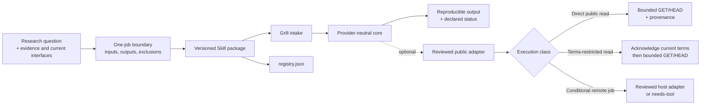
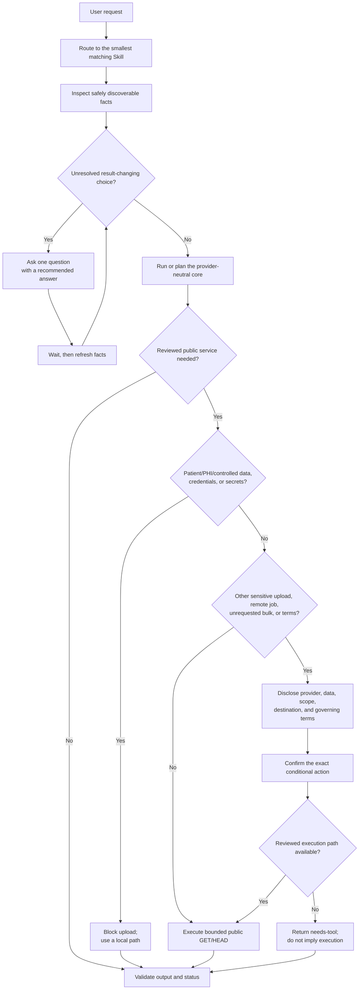

# Repository and Skill architecture

## Research-first system

The verified `main` Beta contains 32 independently installable, one-job bioinformatics Skills across 11 Domains and 19 Clusters. The `research` branch adds three Wave R2 candidates, bringing the branch to 35 packages across 13 Domains and 21 Clusters. Candidates remain outside the Beta until their common and candidate-specific promotion gates pass.



Only the one-job Skill directory is installable. Domains and Clusters organize the catalog; tools, databases, connectors, adapters, fixtures, and review roles do not increase the Skill count.

## Invocation contract

Every package follows the same fact-first Grill interaction contract.



Ask no question when facts already resolve the choice. Ask exactly one question at a time when a load-bearing choice remains. An explicit request authorizes its bounded public read and requested download; it does not silently authorize a sensitive upload, remote job, unrequested bulk expansion, new external write, destructive action, controlled-data access, or physical execution.

## Public connector contract

The v0.7.0 public connector contract has four execution boundaries:

1. **Bounded public access.** A user's explicit search or retrieval request authorizes the matching allowlisted public `GET` or `HEAD` and requested download. The shared companion enforces reviewed HTTPS hosts and path prefixes, timeouts, retry limits, page and byte caps, redirect checks, non-overwriting output publication, and pacing between paginated requests within one invocation; retry backoff is separate. The agent host must aggregate rate limits across concurrent processes and other traffic sharing the same source address.
2. **Anonymous-only companion.** The shared companion reads no provider configuration, contact identity, API key, token, or paid credential. Transport follows the agent host's proxy and CA trust policy; a non-default proxy or CA boundary should be disclosed. A host may provide a separate authenticated adapter only after disclosing that adapter's data, identity, storage, and billing boundary.
3. **Conditional actions.** Patient data, protected health information, controlled-access data, credentials, and secrets are never uploaded. For other non-prohibited sensitive data, disclose and confirm the exact scope before upload or remote compute submission. Unrequested bulk expansion and terms-restricted reads also require scoped confirmation. KEGG public academic use requires its explicit terms acknowledgement. A confirmation never expands beyond the named data, provider, operation, and scope.
4. **No active paid path.** Metered and paid providers are absent from the executable catalog. The shared companion does not read paid credentials or switch to a paid fallback.

The shared companion at `scripts/run_research_connector.py` currently executes
`GET` and `HEAD` only. Its direct-read providers cover public database queries
and bounded downloads; its terms-read path adds a declared terms gate. Hosted
alignment and remote BLAST remain `conditional-job` providers: they require a
reviewed adapter supplied by the agent host, and otherwise degrade to
`needs-tool` without claiming submission.

Status is evidence-backed. The shared companion emits `completed` only for a
checked live response and a create-new, checked payload/provenance pair with
`network_performed=true`; otherwise it emits `blocked-or-failed` and reports
whether the network was reached. At the Skill layer, incomplete or truncated
retrieval stays partial and non-completed, and unsupported jobs return
`needs-tool`. `Completed` establishes checked retrieval and publication, not
scientific relevance, biological correctness, or domain-level semantic
validation. Provenance binds the provider, redacted request, method,
timestamps, responses, byte count, output digest, pagination, anonymous mode,
and terms state.

## Package skeleton

```text
02-bio-skills/
├── README.md
├── AGENTS.md
├── CONTRIBUTING.md
├── LICENSE
├── registry.json
├── docs/
├── templates/skill/
├── scripts/validate_skeleton.py
└── skills/
    ├── README.md
    └── <skill-name>/
        ├── LICENSE              Apache-2.0 terms
        ├── SKILL.md
        ├── manifest.json
        ├── agents/interface.yaml
        ├── references/           only when directly used
        ├── scripts/              original, reviewed, self-tested logic only
        └── NOTICE                when third-party obligations require it
```

Every installable package declares:

- activation description, owned outcome, inputs, outputs, and near-neighbor exclusions;
- assumptions, failure states, safety limits, and human-judgment boundaries;
- Domain, Cluster, risk, owner, version, freshness, review cadence, and rollback boundary;
- `release_stage` and `assurance_level`;
- runtime, scientific-benchmark, baseline-comparison, and clinical-use claim boundaries;
- optional adapters and their network, data, credential, version, and verification limits;
- bundled-script origin and deterministic self-test status;
- legally required notices.

Research candidates follow the same package contract but are not release
claims. Their promotion requirements are recorded in
[Research Skill promotion gates](research-skill-promotion-gates.md), and their
unverified evidence remains explicit until a reviewed `research`-to-`main`
promotion.

Packages remain flat under `skills/<slug>/`; catalog reorganization does not move installed files. `SKILL.md` stays lean, domain depth belongs in referenced files, and deterministic repeated logic belongs in an original reviewed script.

## Lifecycle boundary

Package and registry metadata are admitted together and joined by name, version, and canonical package digest. `preview + reviewed` may omit runtime, scientific, or human evaluation only when that absence and every resulting unverified boundary are explicit. See [Release flow](release-flow.md).
