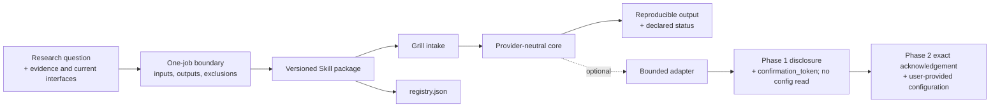
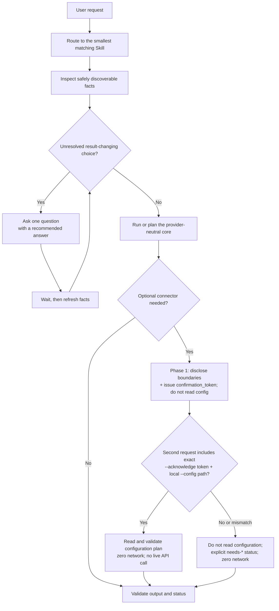

# Repository and Skill architecture

## Research-first system

The repository contains 20 independently installable, one-job bioinformatics Skills. Research questions, current evidence, official tool interfaces, scientific assumptions, and failure boundaries are reviewed before a package is admitted.



Only the one-job Skill directory is installable. Domains and Clusters organize the catalog; tools, databases, connectors, adapters, fixtures, and review roles do not increase the Skill count.

## Invocation contract

Every package follows the same fact-first Grill interaction contract.



Ask no question when facts already resolve the choice. Ask exactly one question at a time when a load-bearing choice remains. Do not repeat confirmation for an already requested safe local action, and never expand that authorization to a new upload, payment, external write, destructive action, controlled-data access, or physical execution.

## Connector contract

A connector configuration is user- or host-provided runtime input, not package content. Access uses two separate requests.

1. **Phase 1 — disclose only.** Disclose provider, purpose, fields or files that would be sent, credential requirement, network destination, rate/cost boundary, and output location. Return a `confirmation_token`. Do not open, parse, stat, validate, or otherwise read connector configuration, even if a path or reference was supplied early.
2. **Phase 2 — exact acknowledgement.** Read configuration only when a later request contains both `--acknowledge <exact-confirmation-token>` and `--config <path>` for a local JSON file.
3. Reject a missing or mismatched token before reading configuration. The acknowledgement applies only to the disclosure and task scope bound to that exact token.
4. After a valid acknowledgement, the v0.2.0 doctor may read and validate only the connector plan within that acknowledged scope. It never performs a live API call. Never echo, persist, infer, or manufacture credentials.
5. Missing or mismatched acknowledgement returns `needs-user-confirmation` before any configuration access. After valid acknowledgement, absent configuration or credentials returns `needs-user-config` or `needs-credential`. These are non-secret plan results and make zero network calls.

The placeholder is an output aid, not an incomplete package or silently persisted configuration. Issuing a token is not permission to read configuration or use the network. A future live adapter would require a separate reviewed implementation and fresh execution approval; none is bundled in v0.2.0. Optional adapters remain provider-neutral at the Skill boundary and cannot silently fall back to another service.

## Package skeleton

```text
02-bio-skills/
├── README.md
├── AGENTS.md
├── CONTRIBUTING.md
├── registry.json
├── docs/
├── templates/skill/
├── scripts/validate_skeleton.py
└── skills/
    ├── README.md
    └── <skill-name>/
        ├── SKILL.md
        ├── manifest.json
        ├── agents/interface.yaml
        ├── references/           only when directly used
        ├── scripts/              original, reviewed, self-tested logic only
        └── LICENSE or NOTICE     whenever legally required
```

Every installable package declares:

- activation description, owned outcome, inputs, outputs, and near-neighbor exclusions;
- assumptions, failure states, safety limits, and human-judgment boundaries;
- Domain, Cluster, risk, owner, version, freshness, review cadence, and rollback boundary;
- `release_stage` and `assurance_level`;
- runtime, scientific-benchmark, baseline-comparison, and clinical-use claim boundaries;
- optional adapters and their network, data, credential, version, and verification limits;
- bundled-script origin and deterministic self-test status;
- legally required notices.

Packages remain flat under `skills/<slug>/`; catalog reorganization does not move installed files. `SKILL.md` stays lean, domain depth belongs in referenced files, and deterministic repeated logic belongs in an original reviewed script.

## Lifecycle boundary

Package and registry metadata are admitted together and joined by name, version, and canonical package digest. `preview + reviewed` may omit runtime, scientific, or human evaluation only when that absence and every resulting unverified boundary are explicit. See [Release flow](release-flow.md).
