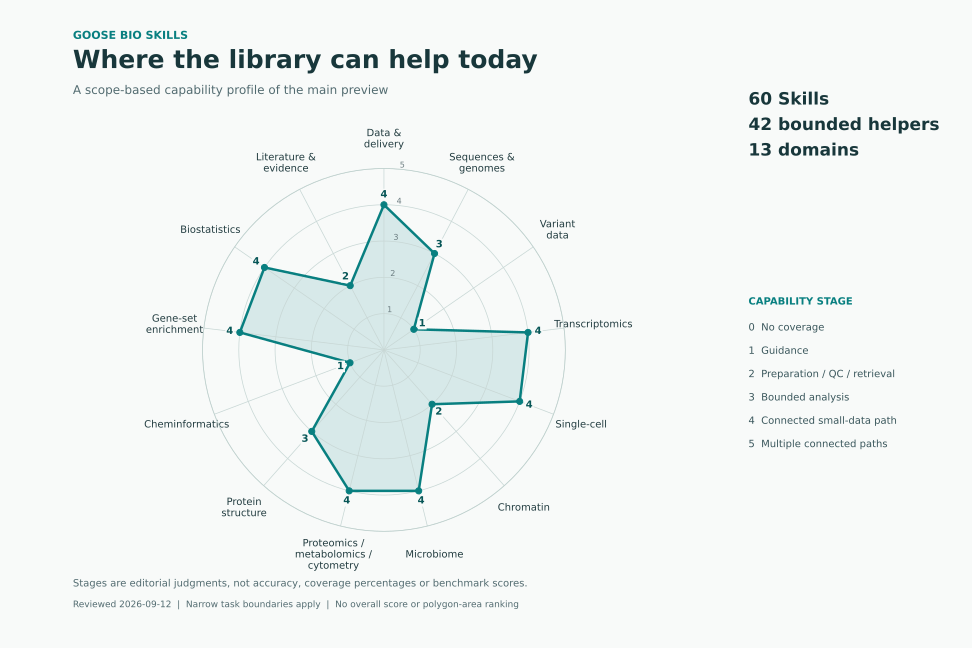

# 领域能力画像

评审日期：2026-09-13。对象是当前 main 的 60 个 Skill 和 43 个内置 helper，不是不可变 v0.9.0 集合。所有 Skill 仍为 `preview + reviewed`。这是阅读实际 Skill、manifest、脚本及现有小数据交付记录后的**能力阶段判断**，不是正确率、领域覆盖百分比、用户满意度或模型基准。



## 如何分领域、如何评分

沿用 registry 的 D01–D13，避免为了画图改动安装路径和路由。展示名按当前实际范围收窄：D05 不声称已有空间分析，D11 不声称已有复杂多组学，D13 不声称临床解释。D01 是共享基础能力，其余轴也并非相互独立。一个 Skill 只按原有主领域计数一次；表达分析使用的共享绘图/统计/富集不会重复记入 D04。

| 阶段 | 可复核含义 |
| ---: | --- |
| 0 | 没有声明覆盖 |
| 1 | 有边界明确的指导，执行尚需适配器 |
| 2 | 有限定范围的数据准备、QC 或检索 |
| 3 | 能做一种或多种限定范围的分析计算 |
| 4 | 已有至少一条从输入到分析和交付的小数据连接路径 |
| 5 | 多条不同的常用路径均已连接并有相应小数据记录；当前暂不赋此档 |

分值是领域的保守概括，不是将 Skill 数、脚本数相加或取平均。QC 有脚本不等于具备下游推断；无内置脚本也可能通过单独安装的共享连接器检索。4 分表示某条有限路径已衔接，不能推出整个领域成熟。没有用户反馈不妨碍内部盘点，但不能据此声称真实需求已验证。等级是有序档位，雷达图连接线只辅助浏览，不比较多边形面积、不计算综合分。

<!-- capability-table:start -->

| 领域 | Skill / helper | 阶段（0–5） | 评分依据 | 主要边界 |
| --- | ---: | ---: | --- | --- |
| D01 数据整理与分析交付 | 10 / 7 | 4 | 样本检查、ID/参考资源准备、公共表达整理、图表与报告已经接入小型表达流程。 | 共享基础能力；不等于任意文件和任意环境均可执行。 |
| D02 序列、基因组与进化 | 11 / 5 | 4 | 已有 read QC、限定比对、基因模型/树文件检查；同版本 BED3 相交/合并现已连接非空峰集 QC、逐行区间图、报告和带指纹交接。 | 新增路径只支持小型 BED3；不含 liftover、链特异操作、自动基因注释、全基因组性能或完整组装/进化流水线。 |
| D03 变异数据处理 | 1 / 0 | 1 | VCF 操作有明确参考与基因型语义指导，但该领域没有内置 helper。 | 不包含已执行的变异检测、GWAS、群体遗传或因果推断。 |
| D04 转录组与表达分析 | 6 / 6 | 4 | counts、微阵列及剪接 helper 已连接表达交付；新增单运行 RT-qPCR 的技术 QC、效率校正相对量、逐对象图及报告。 | 限定小数据与独立对象；qPCR 不做缺失填补、自动内参选择、跨板校准、组间检验或效率不确定性传播。 |
| D05 单细胞分析 | 4 / 4 | 4 | 小型 h5ad 的 QC、核心探索、marker 证据和 pseudobulk 可串接现有差异分析。 | 当前评分不覆盖空间组学、大型对象、轨迹、细胞通讯或自动最终注释。 |
| D06 染色质与表观遗传 | 1 / 1 | 2 | 已有同版本峰集的坐标、黑名单和覆盖重叠 QC。 | 没有 peak calling、差异可及性、motif、FRiP 或 IDR 执行链路。 |
| D07 微生物组分析 | 4 / 4 | 4 | 整数特征表的 beta 距离已接 PCoA、分组图和报告；8 样本检查保留负特征值并核对距离重建。 | 不包含自动归一化、稀释、PERMANOVA、差异丰度、宏基因组组装或病原判断。 |
| D08 蛋白组、代谢组与流式 | 6 / 5 | 4 | 蛋白定量表 QC 已接完整 log2 limma、图表报告；100 蛋白 × 8 样本跑通，缺失/未知尺度/重复对象阻断建模。 | 组合领域；此档位由蛋白路径支持。蛋白组 2 包/2 helper，代谢组 1/1，流式 3/2；不含原始质谱、自动填补或自动门控。 |
| D09 蛋白质结构 | 2 / 1 | 3 | 有本地蛋白界面接触分析，并有公共结构获取/比较的指导和共享检索入口。 | 结构比对不等于已内置并验证；不支持新结构预测、对接、动力学或亲和力推断。 |
| D10 化学信息 | 2 / 0 | 1 | 分子标准化、描述符和相似性搜索有边界清晰的指导，但没有内置 helper。 | 不声称可运行药物筛选、活性预测或药物发现流程。 |
| D11 功能富集 | 2 / 2 | 4 | ORA 和有符号排名 GSEA 均有脚本，可接表达映射和结果报告。 | 评分只覆盖基因集富集；网络推断、多组学融合和通路激活判断不在内。 |
| D12 研究设计与生物统计 | 8 / 7 | 4 | 已有两组连续量、相关、生存及多重校正；新增独立 2×2 的 Fisher、条件优势比/精确区间、计数图与报告。 | 不包含复杂回归、配对分类结局；2×2 OR 不是风险比，病例对照行比例不估计总体风险。 |
| D13 文献与公共证据 | 3 / 1 | 2 | 有文献/公共研究检索指导与共享连接器，变异证据有本地规范化 helper。 | 文件内置脚本数不包括共享连接器；不代表自动系统综述或临床解释。 |

<!-- capability-table:end -->

## 计数、证据与维护

数据清单：[capability-profile.json](data/capability-profile.json)。其中记录每个领域的理由、边界、下一步，以及全部 Skill 的名称、主领域、manifest 指纹和 registry 包指纹。对应能力可从 [完整目录](catalog.md)、[表达流程](expression-workflows.md)、[扩展示例](../examples/expansion/README.md) 和 [基础示例](../examples/efficiency/README.md) 核对。40 个 helper 恰好分布在 40 个包，另 18 个包不带脚本；这个计数不包括仓库级连接器、安装器和图表生成脚本。

D08 保留原有组合分类，但三个子领域并不等强：蛋白组 2 个 Skill / 2 个 helper，代谢组 1/1，流式 3/2。蛋白质结构单列 D09，因为结构文件、残基/链映射与丰度矩阵的任务不同。后续这些子领域明显扩展时再拆展示轴，先不迁移包。

图中数据不是合成实验数据；它是有理由与文件依据的人工评审元数据。本批使用原始合成小表检查执行与几何性质，没有代表性生物学验证。新增包或改变范围时，先复核档位，再更新数据清单、表格与图；**不随包数量自动提分**。生成图的 Matplotlib 仅用于维护文档，用户安装 Skill 不需要此依赖。

```bash
python3 scripts/render_capability_profile.py --check
# 在已有 Matplotlib 环境中重建文档图与表：
python3 scripts/render_capability_profile.py
```

`--check` 只用标准库，核对全量归属、manifest/registry 身份、计数、表格与图的数据/文件指纹。它不代替人工检查图的清晰度，也不重新评定分值。PNG/SVG 是同一份数据生成的静态文档资源，没有远程字体或服务。

[下一步实施计划](next-steps.md) 按“补断点、跨任务复用、实现代价和输入边界”排序，不按雷达图最低分机械填空。

本批 D02 从 3 调整为 4，依据是 BED3 运算、非空峰集 QC、图表及报告的实际小表连接检查；不是按新增脚本数加分。范围仅是这一条已连接路径，其他领域保持原档位。
