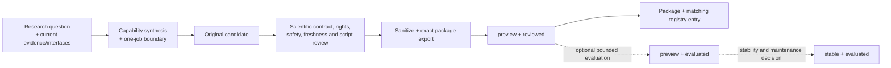

# Research-to-release flow

`registry.json` is the versioned index of installable packages, not a roadmap. A planned Skill appears in neither `skills/` nor the registry.

## Flow

Research comes first, but preview admission stays lightweight: it requires a reviewed, exact, installable package with truthful boundaries, not a mandatory chain of large runtime, scientific, or expert exercises.

## Two independent axes

| `release_stage` | `assurance_level` | Allowed | Meaning |
| --- | --- | --- | --- |
| `preview` | `reviewed` | yes | The exact package passed its declared research-contract, rights, safety, dependency, sanitization, static package, script, and install-smoke review; runtime evaluation may be absent |
| `preview` | `evaluated` | yes | A bounded evaluation of the exact preview package is recorded |
| `stable` | `evaluated` | yes | The evaluated package also passed stability, maintenance, and rollback review |
| `stable` | `reviewed` | no | Stability cannot be claimed without bounded exact-package evaluation |

`Reviewed` is not a synonym for validated. `Evaluated` applies only to its recorded inputs, versions, methods, and boundaries. Neither state establishes universal biological correctness or clinical authority.

## Minimum preview gates

1. **Research contract:** the recurring job, inputs, outputs, exclusions, current official/scientific interfaces, assumptions, limits, and owner review are bound to the candidate.
2. **Rights and trust:** redistribution obligations and required `LICENSE`, `NOTICE`, copyright, or attribution are resolved; dependencies, writes, secrets, protected data, and optional adapters are reviewed.
3. **Interaction and connectors:** Grill is fact-first and asks one recommended question at a time only when needed. Connector access is two-phase: first disclose and issue a `confirmation_token` without reading configuration; only a later request with both `--acknowledge <exact-confirmation-token>` and a local `--config <path>` may read it. Exact zero-network outcomes are `needs-user-confirmation`, `needs-user-config`, `needs-credential`, and `config-validated`.
4. **Original implementation:** every bundled deterministic script is an original reviewed implementation and passes an offline self-test. Batch, GPU, network, or complex-tool runtime work may be skipped only with the reason, relevant versions, and exact unverified boundary.
5. **Sanitized atomic admission:** the exact file set, package digest, and matching registry entry are admitted together; private paths, credentials, protected data, hidden network behavior, and unlicensed material are absent.

A `preview + reviewed` package may omit a runtime evaluation, scientific benchmark, baseline comparison, or human-expert review when the manifest states that truth. A skipped path is disclosure, not a pass.

## Connector release boundary

Connector configuration is supplied by the user or host at runtime. It is not bundled in a Skill package or registry entry.

The first request must only disclose provider, purpose, data sent, credential requirement, network destination, rate/cost boundary, and output location, then issue a disclosure-bound `confirmation_token`. It must not read configuration, including a path or reference supplied before acknowledgement.

A second request may read a local configuration file only when it supplies both `--acknowledge <exact-confirmation-token>` and `--config <path>`. Missing or mismatched acknowledgement fails before configuration access with `needs-user-confirmation`. After acknowledgement, an absent configuration or required credential returns `needs-user-config` or `needs-credential`; a valid plan returns `config-validated`. Every result is zero-network. The token binds the disclosed provider set and catalog boundary; it does not authorize a live call or broaden any other permission.

The v0.2.0 connector doctor stops at configuration-plan validation and always reports zero network activity. No live API client is bundled; adding one requires a separate reviewed implementation and fresh execution approval.

## Evaluation and stability

Moving `assurance_level` to `evaluated` requires actual, bounded evidence for the exact package; changing a label is insufficient. Skipped checks remain visible and outside the assurance claim.

Moving `release_stage` to `stable` additionally requires:

- `assurance_level: evaluated`;
- no unresolved critical issue in the stable core;
- maintained dependency and freshness boundaries;
- an owner-approved exact rollback target.

Optional complex behavior may remain unverified only when it is explicitly outside the stable claim.

## Atomic admission

Each installable version changes two public objects together:

1. one complete `skills/<name>/` package;
2. the matching `registry.json` entry with the same name, version, Domain, Cluster, release stage, assurance level, previous version, and canonical package digest.

Incomplete package placeholders, partial directories, roadmap entries, and mismatched lifecycle metadata are rejected. A runtime connector placeholder is different: it is a non-secret dry-run output and is never treated as an installable package.

The canonical package digest is SHA-256 of canonical JSON for the path-sorted `[{path, sha256, kind}]` inventory. `manifest.json` and `agents/interface.yaml` are metadata; files under `scripts/` or with recognized code suffixes are code; legal-notice prefixes are license material; other files are text.

## Rollback and public boundary

Rollback targets one exact package version and its registry entry. Research history, rights decisions, failed or partial evaluations, and previous release evidence remain intact.

An installable package may contain newly written instructions, original reviewed scripts, necessary runtime references, neutral maintenance metadata, and legally mandatory notices. It may not contain copied or unlicensed material, private URLs or paths, credentials, private discussion text, hidden network behavior, protected data, or reversible private identifiers.
