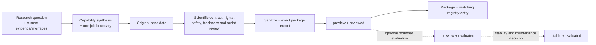

# Research-to-release flow

`registry.json` is the versioned index of installable packages, not a roadmap. A planned Skill appears in neither `skills/` nor the registry.

Version `0.8.0` admits 44 exact packages across 13 Domains and 26 Clusters under the same atomic package-and-registry boundary.

## Flow

Research comes first, but preview admission stays lightweight: it requires a reviewed, exact, installable package with truthful boundaries, not a mandatory chain of large runtime, scientific, or expert exercises.

## Two independent axes

| `release_stage` | `assurance_level` | Allowed | Meaning |
| --- | --- | --- | --- |
| `preview` | `reviewed` | yes | The exact package passed its declared research-contract, rights, safety, dependency, sanitization, static package, script, and install-smoke review; runtime evaluation may be absent |
| `preview` | `evaluated` | yes | A bounded evaluation of the exact preview package is recorded |
| `stable` | `evaluated` | yes | The evaluated package also passed stability, maintenance, and rollback review |
| `stable` | `reviewed` | no | Stability cannot be claimed without bounded exact-package evaluation |

`Reviewed` is not a synonym for validated. `Evaluated` applies only to its recorded inputs, versions, methods, and boundaries. Neither state establishes universal biological correctness or clinical authority.

## Minimum preview gates

1. **Research contract:** the recurring job, inputs, outputs, exclusions, current official/scientific interfaces, assumptions, limits, and owner review are bound to the candidate.
2. **Rights and trust:** redistribution obligations and required `LICENSE`, `NOTICE`, copyright, or attribution are resolved; dependencies, writes, secrets, protected data, and optional adapters are reviewed.
3. **Interaction and public services:** Grill is fact-first and asks one recommended question at a time only when needed. An explicit request authorizes its bounded allowlisted public read and requested download. The shared companion is anonymous-only. Patient data, protected health information, controlled-access data, credentials, and secrets are never uploaded. Other non-prohibited sensitive uploads, remote jobs, unrequested bulk expansion, and terms-restricted access require an exact scoped confirmation. Paid or metered providers are absent from the executable catalog.
4. **Original implementation:** every bundled deterministic script is an original reviewed implementation and passes an offline self-test. Batch, GPU, network, or complex-tool runtime work may be skipped only with the reason, relevant versions, and exact unverified boundary.
5. **Sanitized atomic admission:** the exact file set, package digest, and matching registry entry are admitted together; private paths, credentials, protected data, hidden network behavior, and unlicensed material are absent.

A `preview + reviewed` package may omit a runtime evaluation, scientific benchmark, baseline comparison, or human-expert review when the manifest states that truth. A skipped path is disclosure, not a pass.

## Connector release boundary

Public-service declarations are package metadata. The shared companion does not
accept identity or credential values. Any separate host adapter that uses them
must disclose its own boundary and never bundle secrets in a package or registry.

The v0.8.0 executable catalog contains reviewed public-free and
terms-restricted providers only. A user's explicit search or retrieval request
authorizes the matching bounded `GET` or `HEAD` and requested download without a
second acknowledgement. The shared companion at
`scripts/run_research_connector.py` enforces the provider allowlist, HTTPS host
and path prefixes, retry, timeout, pagination and byte limits, redirect checks,
secret redaction, non-overwriting output publication, and provider pacing within
one paginated invocation; retry backoff is separate. The agent host must
aggregate rate limits across concurrent processes and other traffic sharing the
same source address.

The shared companion reads no provider configuration or credentials and uses
anonymous access only. Transport follows the agent host's proxy and CA trust
policy; a non-default proxy or CA boundary should be disclosed. Paid credentials
and paid fallbacks are outside the executable boundary.

Patient data, protected health information, controlled-access data,
credentials, and secrets are never uploaded. Confirmation is conditional, not
universal: disclose the provider, data, operation, scope, destination, and
governing terms before another non-prohibited sensitive upload, remote compute
job, unrequested bulk expansion, or terms-restricted read. The shared companion
currently implements public `GET`/`HEAD` only. Hosted alignment and remote BLAST
therefore require a reviewed host adapter; when none is available, the package
returns `needs-tool` and must not imply that a job was submitted.

Execution claims follow evidence. The shared companion emits `completed` only
when a live response was checked and a create-new, checked payload/provenance pair was
published with `network_performed=true`; otherwise it emits
`blocked-or-failed`, reports whether network access began, and leaves no success
artifact. At the Skill layer, incomplete or truncated work is partial and
non-completed, while an unsupported job is `needs-tool`. `Completed` means the
retrieval and publication contract was checked; it is not a scientific or
semantic validation claim. Provenance records the
provider, redacted request, method, response metadata, timestamps, pagination,
bytes, digest, output, anonymous execution state, and terms state.

## Evaluation and stability

Moving `assurance_level` to `evaluated` requires actual, bounded evidence for the exact package; changing a label is insufficient. Skipped checks remain visible and outside the assurance claim.

Moving `release_stage` to `stable` additionally requires:

- `assurance_level: evaluated`;
- no unresolved critical issue in the stable core;
- maintained dependency and freshness boundaries;
- an owner-approved exact rollback target.

Optional complex behavior may remain unverified only when it is explicitly outside the stable claim.

## Atomic admission

Each installable version changes two public objects together:

1. one complete `skills/<name>/` package;
2. the matching `registry.json` entry with the same name, version, Domain, Cluster, release stage, assurance level, previous version, and canonical package digest.

Incomplete package placeholders, partial directories, roadmap entries, and mismatched lifecycle metadata are rejected. An unsupported conditional external action is a truthful `needs-tool` runtime outcome, not an installable package or a claimed execution.

The canonical package digest is SHA-256 of canonical JSON for the path-sorted `[{path, sha256, kind}]` inventory. `manifest.json` and `agents/interface.yaml` are metadata; files under `scripts/` or with recognized code suffixes are code; legal-notice prefixes are license material; other files are text.

## Rollback and public boundary

Rollback targets one exact package version and its registry entry. Research history, rights decisions, failed or partial evaluations, and previous release evidence remain intact.

An installable package may contain newly written instructions, original reviewed scripts, necessary runtime references, neutral maintenance metadata, and legally mandatory notices. It may not contain copied or unlicensed material, private URLs or paths, credentials, private discussion text, hidden network behavior, protected data, or reversible private identifiers.
