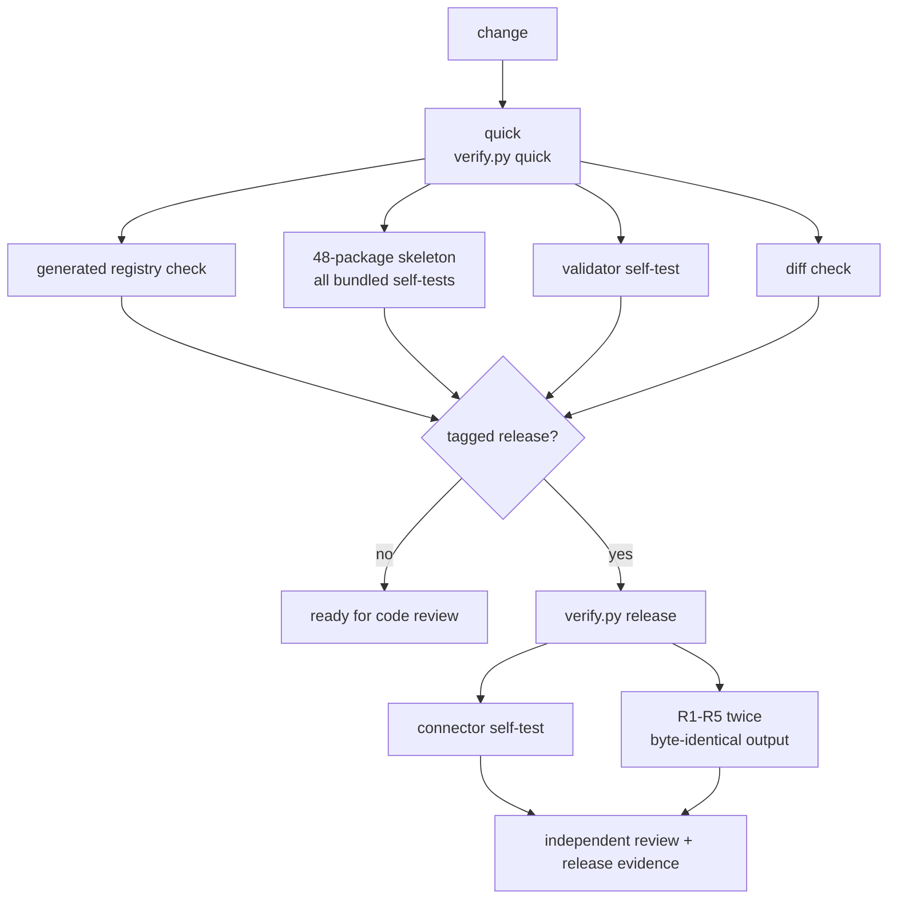

# Verification pipeline

Goose Bio Skills has two verification modes, not eight separate contributor decisions.
The existing gates remain independently runnable and retain their historical
evidence; the thin orchestrator only chooses and reports them.



## Commands

```bash
python3 scripts/verify.py quick
python3 scripts/verify.py release
```

`quick` is the normal local and pull-request path. It still validates every
package because the full skeleton currently takes only a few seconds and avoids
fragile change detection. `release` adds the connector and two fresh runs of
each retained Wave runner. Full release evidence, CodeGraph refresh, and
independent review remain release activities rather than per-edit gates.

Historical Wave runners are frozen evidence executors. New work should not copy
their hashing, JSON, or subprocess helpers into another Wave runner unless a
new retained evidence boundary genuinely requires it.

The current [source-code graph](codegraph.md) records implementation structure,
not scientific or routing assurance.
